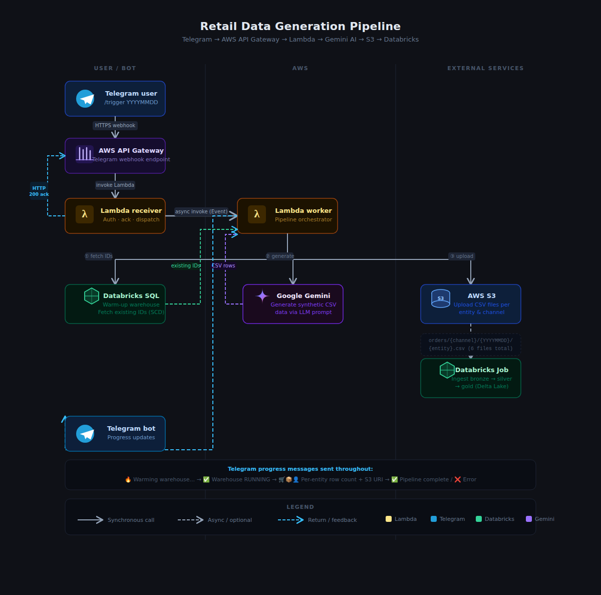

# Retail Data Generation Pipeline



An automated pipeline that uses **Google Gemini** to generate realistic synthetic retail data and uploads it to **AWS S3**, with optional downstream triggering of a **Databricks** ingestion job. The pipeline is designed to run as an **AWS Lambda** function, triggered via a **Telegram bot**.


---

## Architecture Overview

```
Telegram User
     │
     │  /trigger YYYYMMDD
     ▼
┌─────────────────────┐
│  lambda_receiver    │  ← Webhook receiver (returns 200 immediately)
│  (Lambda)           │
└─────────┬───────────┘
          │  async invoke
          ▼
┌─────────────────────┐
│  lambda_worker      │  ← Long-running pipeline worker
│  (Lambda)           │
└─────────┬───────────┘
          │
          ├──► Databricks (fetch existing IDs for SCD logic)
          ├──► Gemini API (generate synthetic CSV data)
          ├──► AWS S3 (upload generated CSVs)
          └──► Databricks Job (trigger ingestion — optional)
```

Progress updates are sent back to the user via Telegram after each step.

---

## Databricks Pipeline

The databricks pipeline code can be found in this repository: [databricks-retail](https://github.com/arana2k/Databricks-Retail)

## Project Structure

```
.
├── lambda_function.py       # Two Lambda handlers (receiver + worker)
├── pipeline_client.py       # RetailDataPipeline orchestration class
├── gemini_client.py         # Gemini API wrapper (data generation)
├── databricks_client.py     # Databricks REST API wrapper (SQL + Jobs)
├── s3_uploader.py           # S3 upload and key-building utilities
├── schema_loader.py         # Loads and validates schemas.json
├── schemas.json             # Entity schema definitions
├── generate_retail_data.py  # CLI entry point (local runs)
└── requirements.txt         # Python dependencies
```

---

## Entities Generated

The pipeline generates data for six entities across two channels:

| Entity | Channel | SCD Type | Description |
|---|---|---|---|
| `online_customers` | Online | SCD1 | Online retail customers |
| `online_products` | Online | SCD2 | Online product catalog |
| `online_orders` | Online | Fact | Online transactions |
| `offline_customers` | Offline | SCD1 | In-store retail customers |
| `offline_products` | Offline | SCD2 | In-store product catalog |
| `offline_orders` | Offline | Fact | In-store transactions |

### SCD Handling

- **SCD2 (Products):** Fetches currently active records (`WHERE is_current = true`) from the Databricks gold table. Gemini generates a mix of updates to existing products and net-new records.
- **SCD1 (Customers):** Fetches existing customer IDs from Databricks. Gemini generates a mix of field updates (e.g. email, city) and new customers.
- **Orders (Fact):** Always generates fresh records. ~80% of `customer_id` and `sku_id` foreign keys are drawn from the IDs generated in the same pipeline run.

### S3 Output Layout

```
s3://<bucket>/orders/<channel>/<YYYYMMDD>/<entity>.csv

# Example
s3://my-bucket/orders/online/20260517/online_orders.csv
s3://my-bucket/orders/online/20260517/online_customers.csv
s3://my-bucket/orders/offline/20260517/offline_products.csv
```

---

## Setup

### Prerequisites

- Python 3.11+
- AWS account with S3 and Lambda access
- Google Gemini API key
- Databricks workspace with a SQL Warehouse
- Telegram bot token (for Lambda deployment)

### Install Dependencies

```bash
pip install -r requirements.txt
```

`requirements.txt`:
```
google-genai>=1.0.0
boto3>=1.34.0
requests>=2.31.0
```

---

## Configuration

### Local (`config.json`)

Create a `config.json` in the project root:

```json
{
  "gemini_api_key": "YOUR_GEMINI_API_KEY",
  "gemini_model": "gemini-3.1-flash-lite",
  "s3_bucket": "your-s3-bucket-name",
  "aws_access_key_id": "YOUR_AWS_KEY",
  "aws_secret_access_key": "YOUR_AWS_SECRET",
  "aws_region": "us-east-1",
  "databricks_host": "https://your-workspace.azuredatabricks.net",
  "databricks_token": "YOUR_DATABRICKS_TOKEN",
  "databricks_warehouse_id": "abc123def456",
  "databricks_catalog": "retail_data",
  "databricks_schema": "bronze",
  "databricks_gold_schema": "gold",
  "ingestion_job_id": "12345",
  "file_date": "20260517",
  "fetch_limit": 100,
  "online_customers_count": 50,
  "online_products_count": 30,
  "online_orders_count": 200,
  "offline_customers_count": 50,
  "offline_products_count": 30,
  "offline_orders_count": 200
}
```

All keys can be overridden with environment variables (uppercased), e.g. `GEMINI_API_KEY`, `S3_BUCKET`, etc.

### Lambda Environment Variables

| Variable | Required | Default | Description |
|---|---|---|---|
| `BOT_TOKEN` | ✅ | — | Telegram bot token |
| `WORKER_LAMBDA` | ✅ (receiver) | `retail-data-worker` | Worker Lambda name/ARN |
| `ALLOWED_USERS` | ✅ (receiver) | — | Comma-separated Telegram user IDs |
| `GEMINI_API_KEY` | ✅ | — | Google Gemini API key |
| `gemini_model` | — | `gemini-3.1-flash-lite` | Gemini model name |
| `S3_BUCKET` | ✅ | — | Target S3 bucket |
| `AWS_ACCESS_KEY_ID_PIPELINE` | — | Lambda role | AWS access key for S3 |
| `AWS_SECRET_ACCESS_KEY_PIPELINE` | — | Lambda role | AWS secret key for S3 |
| `AWS_REGION_PIPELINE` | — | `us-east-1` | AWS region |
| `DATABRICKS_HOST` | ✅ | — | Databricks workspace URL |
| `DATABRICKS_TOKEN` | ✅ | — | Databricks personal access token |
| `DATABRICKS_WAREHOUSE_ID` | ✅ | — | SQL Warehouse ID |
| `DATABRICKS_CATALOG` | — | `retail_data` | Unity Catalog name |
| `DATABRICKS_SCHEMA` | — | `bronze` | Bronze schema name |
| `DATABRICKS_GOLD_SCHEMA` | — | `gold` | Gold schema name |
| `INGESTION_JOB_ID` | — | — | Databricks job ID to trigger after upload |
| `fetch_limit` | — | `100` | Max existing IDs to fetch per entity |
| `ONLINE_CUSTOMERS_COUNT` | — | `50` | Records to generate |
| `ONLINE_PRODUCTS_COUNT` | — | `30` | Records to generate |
| `ONLINE_ORDERS_COUNT` | — | `200` | Records to generate |
| `OFFLINE_CUSTOMERS_COUNT` | — | `50` | Records to generate |
| `OFFLINE_PRODUCTS_COUNT` | — | `30` | Records to generate |
| `OFFLINE_ORDERS_COUNT` | — | `200` | Records to generate |


### Lambda Deployment

As the script is dependent on external libraries, there is a need to package all dependencies into a zip and then uploading it back to console. 

Following commands can be used on Windows machine to export all dependencies, zip them and add the lambda + all dependent files into the zip

For exporting packages

```bash
pip install -r requirements.txt --platform manylinux2014_x86_64 --target ./package --implementation cp --python-version 3.14 --only-binary=:all: --upgrade
```

For ziping these packages

```bash
Compress-Archive -Path .\package\* -DestinationPath .\deployment-package.zip
```

---

## Usage

### Local CLI

Run the full pipeline:
```bash
python generate_retail_data.py --config config.json
```

Override the file date:
```bash
python generate_retail_data.py --config config.json --file-date 20260517
```

Run a single entity (for testing):
```bash
python generate_retail_data.py --config config.json --entity online_orders
```

### Telegram Bot Commands

Once deployed to Lambda and connected to a Telegram webhook:

| Command | Description |
|---|---|
| `/start` | Show available commands |
| `/trigger YYYYMMDD` | Generate and upload data for the given date |
| `/ping` | Health check |
| `/contact` | Show owner contact info |
| `/datawarehouse` | Show data warehouse info |

**Example:**
```
/trigger 20260517
```

The bot will immediately acknowledge the request and then send progress updates as each entity is processed.

---

## Lambda Deployment

The project uses a **two-Lambda architecture** to handle Telegram's 5-second webhook timeout:

**`lambda_receiver`** — lightweight webhook handler that:
1. Parses the incoming Telegram message
2. Validates the user is in `ALLOWED_USERS`
3. Sends an immediate acknowledgement to the user
4. Invokes `lambda_worker` asynchronously (`InvocationType=Event`)
5. Returns HTTP 200 to Telegram

**`lambda_worker`** — long-running pipeline that:
1. Warms up the Databricks SQL Warehouse
2. Fetches existing IDs for SCD entities
3. Calls Gemini to generate data for all 6 entities
4. Uploads CSVs to S3
5. Optionally triggers a downstream Databricks ingestion job
6. Sends Telegram updates throughout


### Recommended Lambda Settings

| Setting | Receiver | Worker |
|---|---|---|
| Timeout | 10s | 15 min |
| Memory | 256 MB | 512 MB |
| Trigger | API Gateway (Telegram webhook) | Invoked by receiver |

---

## Duplicate Date Guard

Before generating any data, the pipeline checks whether files already exist in S3 for the requested `file_date`. If files are found under `orders/online/<date>/` or `orders/offline/<date>/`, the pipeline aborts and notifies the user. This prevents accidental duplicate uploads.

---

## Schemas

Entity schemas are defined in `schemas.json` and loaded at startup via `schema_loader.py`. Each entity definition includes:

- `columns` — ordered list of CSV column names
- `id_prefix` — ID format prefix (e.g. `ONL`, `SKU`, `C`)
- `id_column` — local CSV primary key column
- `gold_table_id_column` — corresponding column name in the Databricks gold table
- `description` — natural language description passed to Gemini for data generation

To add a new entity, add an entry to `schemas.json` and update the pipeline run order in `pipeline_client.py`.
